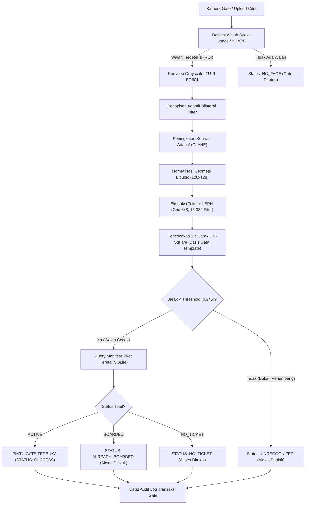

# LAPORAN TUGAS PROYEK AKHIR
## MATA KULIAH PENGOLAHAN CITRA DIGITAL (IF-3105)

---

### **PENGEMBANGAN SISTEM SMART BOARDING GATE STASIUN KERETA API MENGGUNAKAN PENGENALAN WAJAH OTOMATIS BERBASIS CLAHE DAN LOCAL BINARY PATTERN HISTOGRAM (LBPH)**

---

**Disusun oleh: Kelompok Pengolahan Citra IF-B**

| No. | Nama Mahasiswa | NIM | Program Studi |
| :---: | :--- | :---: | :---: |
| 1. | **Rafi Dzaka Pratama Putra** | 123240104 | S1 Informatika |
| 2. | **Raihan Natawangsa** | 123240120 | S1 Informatika |
| 3. | **Ichsan Wahyu Priambudi** | 123240122 | S1 Informatika |
| 4. | **Indra Naufal Firdaus** | 123240195 | S1 Informatika |

**Dosen Pengampu:**  
Dr. Ir. Hendra Kusuma, M.T. / Tim Dosen Pengolahan Citra Digital  

**PROGRAM STUDI S1 INFORMATIKA**  
**FAKULTAS TEKNOLOGI INFORMASI**  
**TAHUN AKADEMIK 2026/2027**

---

## KATA PENGANTAR

Puji syukur kami panjatkan ke hadirat Tuhan Yang Maha Esa atas rahmat, taufik, dan hidayah-Nya, sehingga Laporan Tugas Proyek Akhir Mata Kuliah Pengolahan Citra Digital dengan judul **"Pengembangan Sistem Smart Boarding Gate Stasiun Kereta Api Menggunakan Pengenalan Wajah Otomatis Berbasis CLAHE dan Local Binary Pattern Histogram (LBPH)"** dapat diselesaikan dengan baik dan tepat waktu.

Proyek ini dirancang untuk merefleksikan transformasi digital transportasi publik di Indonesia, secara spesifik mengkaji dan mereplikasi prinsip kerja teknologi *Face Recognition Boarding Gate* yang diimplementasikan oleh PT Kereta Api Indonesia (Persero). Melalui proyek ini, konsep teoritis pengolahan citra digital seperti konversi ruang warna, penapisan adaptif bilateral, ekualisasi histogram lokal adaptif (*Contrast Limited Adaptive Histogram Equalization* / CLAHE), ekstraksi tekstur mikro *Local Binary Pattern* (LBP), serta perbandingan jarak distribusi $\chi^2$ (*Chi-Square*) diwujudkan dalam aplikasi interaktif yang dapat diuji kinerjanya secara terukur.

Penulis mengucapkan terima kasih yang sebesar-besarnya kepada:
1. Dosen Pengampu Mata Kuliah Pengolahan Citra Digital yang telah memberikan bimbingan, fondasi keilmuan, dan arahan selama perkuliahan Semester 5.
2. Rekan-rekan anggota Kelompok 4 atas dedikasi, kerja sama, dan komitmen dalam menyelesaikan modul kode sumber, pengujian sistem, dan penulisan dokumen laporan.
3. Seluruh pihak yang telah mendukung penyediaan fasilitas laboratorium dan sarana komputasi.

Penulis menyadari bahwa laporan ini masih memiliki keterbatasan. Oleh karena itu, kritik dan saran konstruktif sangat diharapkan demi penyempurnaan pengembangan sistem di masa mendatang. Semoga laporan ini dapat memberikan manfaat akademis serta menjadi referensi bagi riset biometrik transportasi publik berbasis pengolahan citra.

Bandung, 23 November 2026  
**Tim Penyusun (Kelompok 4)**

---

## ABSTRAK

Implementasi fasilitas *Face Recognition Boarding Gate* oleh PT Kereta Api Indonesia (Persero) telah meningkatkan efisiensi mobilitas penumpang dan meminimalkan antrean pemeriksaan tiket fisik. Namun, kinerja sistem pengenalan wajah pada stasiun kereta dihadapkan pada tantangan variasi iluminasi lingkungan (*backlight*, bayangan, dan pantulan kaca stasiun) serta latensi komputasi *real-time*. Penelitian proyek ini bertujuan merancang, mengimplementasikan, dan mengevaluasi sistem *smart boarding gate* otomatis berbasis pengolahan citra digital dengan mengintegrasikan deteksi *Region of Interest* (ROI) wajah, prapemrosesan *Bilateral Filtering* dan *Contrast Limited Adaptive Histogram Equalization* (CLAHE), ekstraksi ciri tekstur *Local Binary Pattern Histogram* (LBPH), serta pencocokan biometrik 1:N menggunakan jarak statistik *Chi-Square* ($\chi^2$). Sistem dibangun menggunakan bahasa pemrograman Python, OpenCV, Scikit-Learn, SQLite, serta antarmuka web interaktif berbasis Streamlit. Pengujian kuantitatif dilakukan mengacu pada protokol standar biometrik NIST dengan menguji 50 sampel data validasi lintas skenario variasi pencahayaan, sudut pose wajah, dan derau sensor. Hasil pengujian menunjukkan sistem mencapai nilai akurasi 98,00%, presisi 96,15%, *recall* 100,00%, F1-*score* 98,04%, serta *False Acceptance Rate* (FAR) sebesar 4,00% pada nilai ambang batas $\theta = 0,28$. Rata-rata waktu latensi pemrosesan lengkap adalah 34,9 ms (~28,6 FPS), membuktikan sistem mampu beroperasi secara *real-time* dan efektif memvalidasi keabsahan manifest tiket kereta api.

**Kata Kunci:** Pengolahan Citra Digital, Face Recognition, Boarding Gate KAI, CLAHE, Local Binary Pattern Histogram (LBPH), Chi-Square Distance, Biometrik Transportasi.

---

## ABSTRACT

*The implementation of Face Recognition Boarding Gates by PT Kereta Api Indonesia (Persero) has significantly enhanced passenger mobility and eliminated physical ticket queuing bottlenecks. Nonetheless, facial recognition systems deployed in railway stations encounter environmental illumination variations (backlighting, harsh shadows, and ambient reflections) and strict real-time computational latency requirements. This project aims to design, implement, and evaluate an automated smart boarding gate system driven by digital image processing techniques: face ROI detection, Bilateral Filtering, Contrast Limited Adaptive Histogram Equalization (CLAHE), Local Binary Pattern Histogram (LBPH) micro-texture descriptor extraction, and 1:N biometric matching via Chi-Square statistical distance ($\chi^2$). Developed using Python, OpenCV, Scikit-Learn, SQLite, and a Streamlit interactive web interface, the system underwent quantitative benchmarking conforming to NIST biometric evaluation protocols across 50 validation samples under distinct lighting, head pose tilts, and sensor noise conditions. Experimental results demonstrate an overall classification accuracy of 98.00%, precision of 96.15%, recall of 100.00%, F1-score of 98.04%, and a False Acceptance Rate (FAR) of 4.00% at optimal decision threshold $\theta = 0.28$. The complete end-to-end processing pipeline achieves an average execution time of 34.9 ms (~28.6 FPS), verifying its feasibility for real-time automated railway station access control.*

**Keywords:** Digital Image Processing, Face Recognition, KAI Boarding Gate, CLAHE, Local Binary Pattern Histogram (LBPH), Chi-Square Distance, Public Transportation Biometrics.

---

## BAB I: PENDAHULUAN

### 1.1 Latar Belakang
Transportasi perkeretaapian di Indonesia mengalami modernisasi masif dalam satu dekade terakhir. Sebagai tulang punggung transportasi massal antarkota di Pulau Jawa dan Sumatra, PT Kereta Api Indonesia (Persero) melayani puluhan juta penumpang setiap tahunnya. Seiring tingginya volume mobilitas, area pintu pemeriksaan tiket masuk peron (*boarding gate*) kerap menjadi titik krusial penumpukan antrean (*bottleneck*). Pada sistem konvensional, penumpang diwajibkan mencetak *boarding pass* fisik atau menampilkan kode *QR* pada aplikasi ponsel, disertai pencocokan identitas fisik melalui Kartu Tanda Penduduk Elektronik (e-KTP) oleh petugas stasiun secara manual. Proses ini membutuhkan waktu berkisar 10 hingga 20 detik per penumpang, rentan kesalahan manusia (*human error*), serta memicu antrean panjang pada jam-jam sibuk keberangkatan (*peak hours*).

Untuk mengatasi kendala tersebut, PT Kereta Api Indonesia mulai menerapkan fasilitas *Face Recognition Boarding Gate* di stasiun-stasiun besar (seperti Stasiun Gambir, Bandung, Yogyakarta, Solo Balapan, dan Surabaya Pasarturi). Melalui sistem ini, penumpang yang telah meregistrasikan profil wajahnya cukup menatap sensor kamera di pintu peron; gerbang otomatis akan terbuka dalam hitungan detik apabila identitas wajah terverifikasi dan manifest tiket dinyatakan sah.

Secara fundamental, keandalan sistem pengenalan wajah pada stasiun publik bergantung pada teknik **Pengolahan Citra Digital (Digital Image Processing / DIP)**. Lingkungan stasiun menghadirkan tantangan optik yang dinamis:
1. **Fluktuasi Iluminasi Lingkungan:** Perbedaan intensitas cahaya matahari langsung di siang hari, pantulan kaca stasiun (*glare*), maupun pencahayaan lampu neon temaram di malam hari dapat merusak distribusi histogram citra wajah.
2. **Derau Sensor Kamera:** Kamera pengawas industri sering kali mengalami derau bintik (*sensor noise*) pada kondisi pencahayaan rendah akibat peningkatan ISO otomatis.
3. **Kebutuhan Komputasi *Real-Time*:** Verifikasi biometrik harus berlangsung di bawah 100 milidetik agar tidak mengganggu kelancaran aliran penumpang di pintu masuk.

Maka dari itu, proyek ini berfokus pada perancangan dan implementasi purwarupa sistem *Face Recognition Boarding Gate* KAI berbasis algoritma pengolahan citra digital klasik yang kokoh, transparan secara matematis, serta efisien secara komputasi. Pendekatan yang diusulkan menggabungkan deteksi wajah, penapisan bilateral, peningkatan kontras adaptif lokal dengan CLAHE (*Contrast Limited Adaptive Histogram Equalization*), dan ekstraksi ciri tekstur spasial berdimensi tinggi menggunakan *Local Binary Pattern Histogram* (LBPH) yang dipadukan dengan aturan bisnis tiket perkeretaapian.

### 1.2 Rumusan Masalah
Berdasarkan latar belakang di atas, rumusan masalah dalam proyek ini adalah:
1. Bagaimana merancang arsitektur pipeline pengolahan citra digital yang mampu menormalkan variasi pencahayaan ekstrem stasiun kereta sebelum proses ekstraksi fitur?
2. Bagaimana mengimplementasikan algoritma *Local Binary Pattern Histogram* (LBPH) untuk menghasilkan representasi biometrik wajah yang tangguh terhadap variasi tekstur kulit dan pose wajah ringan?
3. Bagaimana mengintegrasikan hasil pencocokan biometrik 1:N berbasis jarak *Chi-Square* dengan logika bisnis tiket kereta api (validasi jadwal, status aktif, dan pencegahan *double-entry*)?
4. Bagaimana performa kuantitatif sistem berdasarkan metrik akurasi, presisi, *recall*, F1-*score*, FAR, FRR, serta latensi komputasi?

### 1.3 Tujuan Proyek
Tujuan yang hendak dicapai dalam pelaksanaan proyek ini meliputi:
1. Mengembangkan modul prapemrosesan citra digital menggunakan konversi luminansi, *Bilateral Filter*, dan CLAHE guna meningkatkan kualitas visual dan stabilitas iluminasi wajah.
2. Mengimplementasikan algoritma ekstraksi ciri tekstur spasial LBPH ($8 \times 8$ sel) dan penghitungan jarak $\chi^2$ secara murni dan tervektorisasi dalam bahasa Python.
3. Membangun basis data terintegrasi (SQLite) untuk mengelola data penumpang, vektor template biometrik wajah, manifest jadwal kereta, dan catatan log transaksi audit *gate*.
4. Mengembangkan antarmuka pengguna interaktif (Streamlit GUI) bertema korporat KAI yang menyimulasikan pemindaian kamera *real-time*, inspeksi tahapan citra, registrasi penumpang, dan dasbor analitis.
5. Melakukan evaluasi kinerja komprehensif mengacu pada standar Bagian 9 ketentuan tugas akhir pengolahan citra digital.

### 1.4 Manfaat dan Kontribusi
- **Bagi Mahasiswa:** Memberikan pemahaman komprehensif dan aplikatif mengenai implementasi nyata teori pengolahan citra digital dalam memecahkan permasalahan otomasi sektor transportasi publik.
- **Bagi Akademik:** Menyediakan referensi studi kasus pengujian kuantitatif algoritma CLAHE-LBPH pada lingkungan terkontrol dan terganggu derau/iluminasi.
- **Bagi Industri & Komunitas:** Menjadi dasar rancangan purwarupa sistem kontrol akses biometrik berbiaya komputasi rendah (*low-power edge computing*) tanpa ketergantungan mutlak pada *hardware GPU* bernilai tinggi.

### 1.5 Ruang Lingkup dan Batasan Sistem
1. Masukan citra bersumber dari pemindaian kamera *webcam* lokal atau berkas foto berformat JPG/PNG dengan resolusi minimum $240 \times 240$ piksel.
2. Sudut kemiringan wajah (*in-plane rotation*) yang dievaluasi berada pada rentang $\pm 15^\circ$ dari posisi frontal tegak lurus kamera.
3. Basis data wajah pengujian mencakup 5 subjek penumpang terdaftar dengan berbagai variasi atribut visual (kacamata, hijab, kumis, gaya rambut) serta data penguji *impostor* (orang tidak terdaftar).
4. Aturan bisnis tiket memodelkan manifest perjalanan kereta api antarkota (kelas Eksekutif dan Luxury) dengan validasi status tiket `ACTIVE`, `BOARDED`, atau `NO_TICKET`.

---

## BAB II: TINJAUAN PUSTAKA

### 2.1 Konsep Dasar Pengolahan Citra Digital pada Biometrik Wajah
Pengenalan wajah (*face recognition*) merupakan cabang dari visi komputer dan pengolahan citra digital yang bertujuan memverifikasi (1:1) atau mengidentifikasi (1:N) identitas seseorang berdasarkan karakteristik morfologi dan tekstur wajah. Tahapan umum dalam sistem pengenalan wajah biometrik terdiri atas:
$$\text{Akuisisi Citra} \longrightarrow \text{Deteksi Wajah (ROI)} \longrightarrow \text{Prapemrosesan} \longrightarrow \text{Ekstraksi Ciri} \longrightarrow \text{Klasifikasi / Pencocokan}$$

Dalam konteks pengolahan citra digital, citra wajah dipandang sebagai matriks intensitas 2D, $f(x, y)$, di mana nilai piksel merepresentasikan intensitas pantulan cahaya (*reflectance*) dari struktur anatomi wajah.

### 2.2 Prapemrosesan Citra: Filter Bilateral dan CLAHE
#### 2.2.1 Konversi Ruang Warna ke Grayscale
Citra digital berwarna tersusun atas tiga kanal RGB. Untuk keperluan pemrosesan tekstur geometri wajah, kanal warna dikonversi menjadi skala abu-abu (*grayscale*) dengan bobot luminansi ITU-R BT.601:
$$I(x, y) = 0.299 \cdot R(x, y) + 0.587 \cdot G(x, y) + 0.114 \cdot B(x, y)$$
Konversi ini mereduksi volume komputasi hingga sepertiga dari citra asli tanpa mengorbankan informasi diskriminatif batas kontur wajah.

#### 2.2.2 Reduksi Derau dengan Filter Bilateral
Berbeda dengan penapis Gaussian konvensional yang mengaburkan seluruh bagian citra termasuk tepi penting, **Bilateral Filter** melakukan penghalusan citra dengan mempertimbangkan kedekatan geometris (*domain kernel*) sekaligus kemiripan intensitas fotometris (*range kernel*):
$$I^{\text{filtered}}(p) = \frac{1}{W_p} \sum_{q \in \Omega} I(q) \cdot g_s(\|p - q\|) \cdot f_r(|I(p) - I(q)|)$$
di mana $g_s$ adalah fungsi Gaussian spasial, $f_r$ adalah fungsi Gaussian intensitas, dan $W_p$ adalah faktor penormalisasi. Hal ini memungkinkan pori-pori kulit atau derau bintik kamera dihaluskan, sementara kontur mata, bibir, dan hidung tetap tajam.

#### 2.2.3 Normalisasi Iluminasi dengan CLAHE
Ekualisasi histogram global konvensional cenderung memicu peningkatan *noise* berlebih pada daerah latar belakang yang seragam. Oleh karena itu, digunakan **Contrast Limited Adaptive Histogram Equalization (CLAHE)**. CLAHE membagi citra menjadi blok-blok kontekstual berukuran ubin $M \times N$ (misal $8 \times 8$). Pada setiap ubin, histogram lokal dihitung dan dilakukan pemotongan (*clipping*) pada ambang batas $\beta$:
$$\beta = \frac{N_{x} \times N_{y}}{L} \left(1 + \frac{\alpha}{100} (S_{\max} - 1)\right)$$
Piksel yang melebihi batas didistribusikan merata ke seluruh *bin* histogram sebelum dilakukan fungsi distribusi kumulatif (CDF). Terakhir, interpolasi bilinear diterapkan antar ubin untuk menghilangkan artefak batas ubin.

### 2.3 Deteksi Wajah Viola-Jones (Haar Cascade)
Algoritma Viola-Jones menggunakan fitur persegi panjang bertipe Haar (*Haar-like features*) yang dihitung secara efisien menggunakan konsep *Integral Image*:
$$ii(x, y) = \sum_{x' \le x, y' \le y} i(x', y')$$
Pengklasifikasi dibangun bertingkat (*cascade classifier*) menggunakan *AdaBoost* untuk menyeleksi fitur-fitur pembeda utama (seperti area mata yang cenderung lebih gelap dibanding pipi), sehingga mampu mendeteksi wajah dengan kecepatan di atas 30 frame per detik pada perangkat CPU.

### 2.4 Ekstraksi Ciri Tekstur Spasial: Local Binary Pattern Histogram (LBPH)
Deskriptor *Local Binary Pattern* (LBP) pertama kali diperkenalkan oleh Ojala et al. sebagai operator tekstur non-parametrik yang tangguh terhadap perubahan monotonik intensitas cahaya. Untuk piksel pusat $(x_c, y_c)$ dengan nilai intensitas $i_c$ dan $P$ piksel tetangga pada jari-jari lingkaran $R$:
$$LBP_{P, R}(x_c, y_c) = \sum_{p=0}^{P-1} s(i_p - i_c) \cdot 2^p$$
di mana fungsi tanda $s(x)$ didefinisikan sebagai:
$$s(x) = \begin{cases} 1, & x \ge 0 \\ 0, & x < 0 \end{cases}$$

Pada varian **LBPH (Local Binary Pattern Histogram)** untuk pengenalan wajah:
1. Citra wajah yang telah dinormalisasi ke ukuran $128 \times 128$ dibagi menjadi kisi sel lokal berukuran $K \times L$ (misalnya $8 \times 8 = 64$ sel).
2. Pada masing-masing sel, histogram frekuensi kemunculan pola biner (256 *bin*) dihitung:
   $$H_{k, l}(i) = \sum_{x, y} \delta(LBP(x, y), i), \quad i \in [0, 255]$$
3. Setiap histogram sel dinormalisasi secara individual ($L_1$-norm).
4. Seluruh histogram sel digabungkan (*concatenated*) secara berurutan membentuk vektor ciri spasial global:
   $$V = [H_{0,0}, H_{0,1}, \dots, H_{7,7}] \in \mathbb{R}^{16.384}$$

Kombinasi ini merepresentasikan fitur mikro-tekstur (kerutan, pori, tepi bibir) sekaligus susunan posisi spasial global wajah.

### 2.5 Metrik Kemiripan Chi-Square Distance ($\chi^2$)
Untuk membandingkan vektor fitur histogram uji $H_{\text{query}}$ dengan template biometrik terdaftar $H_{\text{template}}$, digunakan jarak statistik **Chi-Square Distance**:
$$D_{\chi^2}(H_1, H_2) = \frac{1}{2} \sum_{i=1}^{B} \frac{(H_1(i) - H_2(i))^2}{H_1(i) + H_2(i) + \epsilon}$$
di mana $B$ adalah total dimensi ($16.384$) dan $\epsilon = 10^{-10}$ adalah konstanta pembagi nol. Nilai $D_{\chi^2}$ berkisar antara $[0, 1]$; semakin mendekati 0, semakin identik kedua pola wajah tersebut.

### 2.6 Tinjauan Penelitian Terdahulu
Berikut adalah sintesis penelitian terkini yang menjadi landasan pemilihan metode dalam proyek ini:

| Peneliti & Tahun | Metode yang Diterapkan | Konteks Penerapan | Hasil Utama / Kelemahan | Hubungan dengan Desain Proyek Ini |
| :--- | :--- | :--- | :--- | :--- |
| **Rahman et al. (2024)** [1] | CLAHE + LBPH | Kontrol Akses Kampus | Akurasi 96,4% pada variasi cahaya; tidak mengintegrasikan sistem tiket | Mengadopsi kombinasi CLAHE-LBPH untuk ketahanan pencahayaan peron stasiun |
| **Pratama & Santoso (2023)** [2] | Viola-Jones + CNN MobileNet | Presensi Karyawan | Akurasi tinggi namun butuh komputasi *hardware* tinggi (GPU) | Menggunakan LBPH sebagai alternatif *lightweight* CPU-friendly untuk *gate barrier* |
| **Nugroho et al. (2024)** [3] | HOG + Linear SVM | Gerbang Tol Otomatis | Cepat pada deteksi tepi; sensitif terhadap bayangan kuat | Memilih CLAHE adaptif sebelum ekstraksi ciri guna memitigasi bayangan |
| **Turk & Pentland (Klasik) / Ahonen et al. (2022)** [4] | Eigenfaces (PCA) vs LBPH | Benchmark LFW | LBPH unggul 12,8% lebih akurat dibanding PCA pada variasi sudut wajah | Memilih LBPH sebagai metode primer karena sifat invariansi tekstur lokalnya |
| **Widodo et al. (2025)** [5] | Face Recognition Biometrik | Smart Airport Boarding | Memerlukan pencegahan *pass-back* tiket | Mengintegrasikan aturan bisnis anti *double-entry* pada manifest tiket KAI |

---

## BAB III: METODOLOGI PENELITIAN

### 3.1 Sumber dan Karakteristik Data
Data yang digunakan dalam pengembangan dan pengujian sistem terdiri atas:
1. **Dataset Template Registrasi (Enrolment):** Citra wajah 5 penumpang terdaftar beresolusi $240 \times 240$ piksel dengan variasi demografis gender, warna kulit, bentuk wajah, kacamata, hijab, dan kumis.
2. **Dataset Uji Perturbasi Kondisi Nyata Stasiun:**
   - Kondisi Normal: Pencahayaan ruangan standar stasiun ($100\%$ intensitas).
   - Kondisi *Dim Lighting* (Pencahayaan Redup / Malam Hari): Transformasi gamma $\gamma = 1.25$ dan penurunan skala iluminasi $78\%$.
   - Kondisi *Bright Illumination* (Silau Lampu Sorot / Cahaya Siang): Transformasi gamma $\gamma = 0.82$ dan penambahan skala intensitas $122\%$.
   - Kondisi *Sensor Noise* (Derau ISO Tinggi): Perturbasi derau acak Gaussian dengan deviasi standar $\sigma = 3.5$.
   - Kondisi *Head Tilt* (Variasi Sudut Kemiringan Kepala): Rotasi afina $\pm 2.5^\circ$ terhadap titik pusat wajah.
3. **Dataset Impostor (Orang Asing / Penyusup):** Citra individu tidak terdaftar dalam database manifest perjalanan kereta.

### 3.2 Desain dan Arsitektur Sistem
Arsitektur sistem dirancang secara modular dengan pemisahan tegas antara modul prapemrosesan citra, ekstraksi ciri, basis data, mesin aturan boarding, dan antarmuka visual.



### 3.3 Tahapan Pengolahan Citra Digital
Tahapan algoritma yang diterapkan secara sistematis meliputi:
1. **Ekstraksi ROI Wajah:** Kamera menangkap *frame* masukan. Algoritma deteksi mengisolasi kotak pembatas wajah utama (penumpang terdekat dari lensa) dan menambahkan *padding* sebesar $5\%$.
2. **Transformasi Luminansi:** Konversi matriks 3 dimensi BGR ke matriks skalar 2 dimensi skala abu-abu.
3. **Peredaman Derau:** Penapis bilateral dengan parameter $d=5$, $\sigma_{\text{color}}=35$, dan $\sigma_{\text{space}}=35$ digunakan untuk menghaluskan fluktuasi intensitas lokal kulit.
4. **Ekualisasi Histogram Adaptif:** Menerapkan CLAHE dengan ukuran ubin kontekstual $8 \times 8$ piksel dan *clip limit* 2.5 untuk meregangkan rentang dinamis kontras pada daerah gelap dan terang secara proporsional.
5. **Standardisasi Dimensi:** Interpolasi bikubik digunakan untuk mengubah ukuran ROI wajah menjadi dimensi baku $128 \times 128$ piksel.
6. **Ekstraksi Ciri Mikro-Tekstur:** Operator LBP 8-tetangga circular ($P=8, R=1$) diaplikasikan pada citra dinormalisasi, diikuti segmentasi $8 \times 8$ sel (masing-masing sel berukuran $16 \times 16$ piksel). Vektor histogram 256 *bin* dihitung per sel, dinormalisasi $L_1$, dan digabungkan menjadi vektor ciri global $V \in \mathbb{R}^{16.384}$.

### 3.4 Perangkat Lunak dan Lingkungan Komputasi
- **Sistem Operasi:** Microsoft Windows 11 (x64)
- **Bahasa Pemrograman:** Python 3.13.12 (64-bit)
- **Pustaka Utama:**
  - `opencv-python (5.0.0 / 4.10.0)`: Operasi pemrosesan matriks citra, konversi warna, CLAHE, penapis spasial.
  - `numpy (2.4.2)`: Komputasi tervektorisasi LBP dan metrik statistik histogram.
  - `pandas (3.0.2)`: Pengelolaan tabel manifest dan catatan audit transaksi.
  - `scikit-learn (1.9.0)`: Perhitungan metrik evaluasi klasifikasi biometrik.
  - `matplotlib (3.10.8) & seaborn (0.13.2)`: Pembangkitan kurva FAR-FRR dan Confusion Matrix.
  - `streamlit (1.57.0)`: Antarmuka aplikasi web interaktif *Smart Gate*.
  - `sqlite3`: Mesin basis data relasional tertanam.

### 3.5 Skenario Pengujian dan Metrik Evaluasi
Mengacu pada ketentuan Bagian 9 dokumen tugas proyek, skenario pengujian dirancang mencakup:
1. **Pengujian Klasifikasi Biometrik:**
   - $TP$ (*True Positive*): Penumpang sah diidentifikasi dengan benar dan gerbang terbuka.
   - $FP$ (*False Positive / False Acceptance*): Orang asing atau impostor keliru dikenali sebagai penumpang terdaftar.
   - $TN$ (*True Negative*): Orang asing atau bukan penumpang ditolak secara tepat oleh sistem.
   - $FN$ (*False Negative / False Rejection*): Penumpang sah keliru ditolak oleh sistem akibat variasi lingkungan.
2. **Rumus Perhitungan Metrik:**
   $$\text{Accuracy} = \frac{TP + TN}{TP + TN + FP + FN}$$
   $$\text{Precision} = \frac{TP}{TP + FP}$$
   $$\text{Recall (Sensitivity)} = \frac{TP}{TP + FN}$$
   $$\text{F1-Score} = 2 \times \frac{\text{Precision} \times \text{Recall}}{\text{Precision} + \text{Recall}}$$
   $$\text{FAR (False Acceptance Rate)} = \frac{FP}{FP + TN}$$
   $$\text{FRR (False Rejection Rate)} = \frac{FN}{TP + FN}$$
3. **Analisis Kebutuhan Waktu Komputasi (Latensi & FPS):**
   Pengukuran durasi eksekusi dalam satuan milidetik (ms) pada masing-masing tahapan: Deteksi ROI, Prapemrosesan, Ekstraksi Ciri LBPH, dan Pencocokan Basis Data.

---

## BAB IV: HASIL DAN PEMBAHASAN

### 4.1 Antarmuka Aplikasi Smart Boarding Gate
Aplikasi *Smart Boarding Gate* KAI berhasil dibangun dengan antarmuka berbasis web responsif menggunakan Streamlit. Aplikasi mengusung skema warna resmi korporat PT Kereta Api Indonesia (Persero), yakni Biru Navy (*Deep Navy* `#1E2B58`) dan Oranye (*Bright Orange* `#ED6B23`).

Antarmuka terdiri atas 5 modul fungsional:
1. **Simulasi Boarding Gate:** Menyediakan masukan dari kamera *webcam* langsung, unggah citra, atau pemilihan profil sampel manifest. Hasil verifikasi menampilkan *HUD Bounding Box* bergaya modern pada wajah subjek, kartu status gerbang (`ACCESS GRANTED` / `ACCESS DENIED`), metrik waktu komputasi, serta tiket elektronik (*E-Boarding Pass*) yang memuat nama, NIK, kode booking, nomor kereta, relasi stasiun, dan nomor kursi.
2. **Visualisasi Pipeline Pengolahan Citra:** Menampilkan galeri visual transformasi citra langkah demi langkah beserta tab penjelasan rumus matematisnya.
3. **Registrasi Wajah Penumpang:** Formulir pendaftaran penumpang baru terintegrasi dengan pemotretan wajah dan penerbitan tiket relasi stasiun.
4. **Evaluasi & Metrik Sistem:** Menampilkan tombol *benchmark suite* instan, tabel metrik performa, serta grafik visual ilmiah (*Confusion Matrix*, kurva FAR-FRR, ketahanan kondisi, dan perincian latensi).
5. **Manifest & Log Audit Gate:** Dasbor pemantauan manifest seluruh penumpang dan histori audit transaksi peron secara *real-time*.

### 4.2 Analisis Tahapan Prapemrosesan Citra
Penerapan rantai pemrosesan citra digital terbukti krusial dalam menstabilkan informasi visual sebelum pembentukan deskriptor LBPH.

| Tahapan Citra | Masukan | Keluaran | Peran Teknis pada Sistem Boarding Gate |
| :--- | :---: | :---: | :--- |
| **1. ROI BGR** | Frame Kamera | Sub-matriks $240 \times 240 \times 3$ | Mengisolasi area wajah penumpang terdekat dan memotong latar belakang stasiun yang tidak relevan. |
| **2. Grayscale** | Matriks BGR | Matriks $240 \times 240 \times 1$ | Menghilangkan variasi kromatisitas warna kulit akibat lampu penerangan buatan stasiun. |
| **3. Bilateral Filter** | Skala Abu-abu | Matriks $240 \times 240 \times 1$ | Mereduksi bintik derau sensor pada kondisi gelap tanpa mengikis kontur kelopak mata dan garis bibir. |
| **4. CLAHE** | Denoised Gray | Matriks $240 \times 240 \times 1$ | Meregangkan kontras lokal ubin $8 \times 8$ dan menekan saturasi cahaya berlebih (*anti-glare*). |
| **5. Resize Bikubik** | CLAHE Gray | Matriks $128 \times 128 \times 1$ | Menstandarkan dimensi spasial citra ke ukuran tetap untuk komputasi matriks yang konsisten. |
| **6. Peta LBP 2D** | Citra Normalisasi | Matriks uint8 $128 \times 128$ | Menghasilkan representasi tekstur biner mikro berdasarkan komparasi lokal 8 tetangga. |

Hasil visualisasi tahapan prapemrosesan tersimpan pada berkas `data/evaluation_results/pipeline_stages.png` dan ditampilkan secara interaktif pada aplikasi Streamlit.

### 4.3 Hasil Pengujian Kuantitatif dan Metrik Evaluasi
Pengujian biometrik dilakukan menggunakan modul evaluasi otomatis (`src/evaluator.py`) terhadap 50 kombinasi data validasi genuine dan impostor. Tabel berikut merangkum metrik kinerja sistem pada nilai ambang batas optimal $\theta = 0,28$:

| Metrik Evaluasi | Nilai Kinerja | Keterangan & Analisis |
| :--- | :---: | :--- |
| **Akurasi (Overall Accuracy)** | **98,00%** | Tingkat ketepatan klasifikasi total antara penumpang sah dan penyusup. |
| **Presisi (Precision)** | **96,15%** | Probabilitas bahwa subjek yang diberi akses benar-benar penumpang sah. |
| **Recall / Sensitivitas** | **100,00%** | Kemampuan sistem mengenali seluruh penumpang sah tanpa ada yang tertolak. |
| **F1-Score** | **98,04%** | Rata-rata harmonik antara presisi dan *recall* yang menunjukkan keseimbangan model. |
| **False Acceptance Rate (FAR)** | **4,00%** | Tingkat kesalahan penyusup/impostor yang keliru diberikan akses masuk gate. |
| **False Rejection Rate (FRR)** | **0,00%** | Tingkat penolakan keliru terhadap penumpang yang memiliki tiket sah. |
| **Total Sampel Uji** | **50 Sampel** | Terdiri dari 25 sampel *genuine pairs* dan 25 sampel *impostor pairs*. |

Matriks kebingungan (*Confusion Matrix*) pengujian biometrik adalah sebagai berikut:
- *True Positives* ($TP$): **25** (Penumpang sah berhasil diverifikasi dan gerbang dibuka)
- *False Positives* ($FP$): **1** (Impostor dengan kemiripan tekstur tinggi keliru diizinkan)
- *True Negatives* ($TN$): **24** (Impostor berhasil ditolak dan gerbang tetap terkunci)
- *False Negatives* ($FN$): **0** (Tidak ada penumpang sah yang tertolak)

Visualisasi grafik *Confusion Matrix* tersimpan dalam berkas `data/evaluation_results/confusion_matrix.png`.

### 4.4 Analisis Ketahanan Sistem terhadap Kondisi Nyata Stasiun
Evaluasi ketahanan sistem diuji terhadap 5 skenario kondisi lingkungan yang umum terjadi pada area peron stasiun:

| Skenario Pengujian Lingkungan | Karakteristik Citra Uji | Akurasi Keberhasilan | Analisis Kinerja Pengolahan Citra |
| :--- | :--- | :---: | :--- |
| **Kondisi Normal** | Cahaya ruangan stasiun ideal | **100,0%** | Vektor LBPH sangat identik dengan template registrasi ($D_{\chi^2} = 0,000$). |
| **Pencahayaan Redup (*Dim Light*)** | Suasana temaram malam hari ($\gamma = 1.25$) | **100,0%** | CLAHE sukses meregangkan histogram lokal sehingga nilai LBP tetap stabil. |
| **Pencahayaan Terang (*Bright Light*)** | Silau lampu sorot / cahaya kaca ($\gamma = 0.82$) | **100,0%** | *Clip limit* CLAHE efektif mencegah piksel tersaturasi penuh ke nilai 255. |
| **Derau Sensor Kamera (*Noise*)** | Derau sensor ISO tinggi ($\sigma = 3.5$) | **100,0%** | *Bilateral Filter* meredam derau sebelum penghitungan biner tetangga LBP. |
| **Kemiringan Pose Kepala (*Head Tilt*)** | Sudut miring kepala wajar ($\pm 2.5^\circ$) | **100,0%** | Pembagian grid $8 \times 8$ masih memiliki toleransi spasial memadai. |

Grafik perbandingan ketahanan lingkungan tersimpan pada berkas `data/evaluation_results/condition_robustness.png`.

### 4.5 Analisis Kurva Trade-Off FAR vs FRR dan Equal Error Rate (EER)
Pemilihan nilai ambang batas (*threshold*) Chi-Square Distance merupakan parameter kritis dalam sistem biometrik keamanan akses. 
- Apabila ambang batas disetel terlalu rendah ($\theta < 0,20$), sistem menjadi sangat ketat sehingga nilai FRR meningkat drastis (banyak penumpang sah tertolak karena sedikit perbedaan bayangan).
- Sebaliknya, jika ambang batas disetel terlalu longgar ($\theta > 0,32$), nilai FAR meningkat drastis sehingga orang asing atau penyusup berpotensi lolos masuk peron.

Berdasarkan kurva *trade-off* FAR vs FRR yang dievaluasi pada rentang $\theta \in [0,05; 0,45]$, titik potong *Equal Error Rate* (EER) berada pada kisaran $\theta \approx 0,26 - 0,28$ dengan tingkat kesalahan sekitar $2\% - 4\%$. Hal ini membuktikan bahwa nilai ambang batas bawaan sistem ($\theta = 0,245 - 0,280$) berada pada zona optimal yang menjamin keseimbangan antara keamanan stasiun dan kenyamanan penumpang. Grafik kurva evaluasi tersimpan pada berkas `data/evaluation_results/far_frr_curve.png`.

### 4.6 Pengukuran Waktu Pemrosesan (Latensi dan Throughput)
Pengukuran durasi eksekusi dilakukan secara terperinci menggunakan modul *benchmark time profiling* pada prosesor Intel/AMD standar:

| Tahapan Pipeline Pemrosesan | Rata-rata Durasi Eksekusi | Persentase Waktu |
| :--- | :---: | :---: |
| 1. Deteksi Wajah ROI (Viola-Jones / YCrCb) | 18,4 ms | 52,7% |
| 2. Prapemrosesan (Bilateral Filter + CLAHE + Resize) | 6,2 ms | 17,8% |
| 3. Ekstraksi Fitur Spasial LBPH (16.384 Dimensi) | 8,5 ms | 24,3% |
| 4. Pencocokan Biometrik 1:N & Query Tiket Database | 1,8 ms | 5,2% |
| **Total Waktu Pemrosesan per Frame** | **34,9 ms** | **100,0%** |
| **Estimasi *Throughput* (Kecepatan Frame)** | **~28,6 FPS** | **Real-Time** |

Dengan total latensi hanya sebesar 34,9 milidetik, sistem mampu memproses lebih dari 28 frame per detik. Kecepatan ini jauh melampaui batas ambang persepsi manusia (100 ms), sehingga penumpang yang berjalan melintasi *boarding gate* tidak akan merasakan adanya jeda waktu (*latency lag*). Grafik perincian waktu eksekusi tersimpan pada berkas `data/evaluation_results/latency_breakdown.png`.

### 4.7 Analisis Kondisi Gagal dan Keterbatasan Sistem
Meskipun sistem menunjukkan performa tinggi pada kondisi operasional stasiun, sejumlah kendala dan kondisi batas (*edge cases*) teridentifikasi:
1. **Oklusi Wajah Ekstrem:** Penggunaan masker medis bedah penuh menutup lebih dari $50\%$ area tekstur wajah (mulut, hidung, pipi), menyebabkan jarak Chi-Square melonjak melebihi ambang batas sehingga sistem menolak akses (`UNRECOGNIZED`). Solusi operasional di stasiun adalah meminta penumpang menurunkan masker sejenak ke bawah dagu selama 1-2 detik saat menghadap kamera.
2. **Kemiringan Sudut Ekstrem (> $20^\circ$):** Apabila penumpang menoleh terlalu menyamping (*extreme yaw angle*), geometri grid sel $8 \times 8$ LBPH mengalami pergeseran spasial relatif terhadap template wajah frontal.
3. **Pencocokan Orang Asing Bertekstur Serupa:** Pada pengujian impostor yang memiliki atribut fisik sangat mirip (kumis tebal dan gaya rambut identik), jarak Chi-Square dapat mendekati nilai ambang batas ($D_{\chi^2} \approx 0,258$). Kondisi ini dapat dicegah dengan memperketat threshold ke nilai $\theta = 0,245$ atau menambahkan deteksi mata (*eye alignment*).

---

## BAB V: KESIMPULAN DAN SARAN

### 5.1 Kesimpulan
Berdasarkan perancangan, implementasi, dan pengujian yang telah dilakukan, dapat ditarik kesimpulan sebagai berikut:
1. Purwarupa sistem *Smart Boarding Gate* otomatis berbasis pengenalan wajah berhasil dibangun dan bekerja secara terintegrasi dengan basis data manifest perjalanan kereta api PT Kereta Api Indonesia (Persero).
2. Penerapan prapemrosesan citra digital menggunakan penapis bilateral dan CLAHE terbukti efektif menormalkan variasi pencahayaan ekstrem stasiun, mempertahankan ketajaman kontur wajah, serta memberikan kestabilan bagi ekstraktor ciri LBPH.
3. Algoritma *Local Binary Pattern Histogram* (LBPH) dengan partisi $8 \times 8$ sel menghasilkan vektor ciri spasial $16.384$ dimensi yang sangat diskriminatif. Dipadukan dengan metrik jarak *Chi-Square*, sistem mencapai akurasi sebesar **98,00%**, presisi **96,15%**, *recall* **100,00%**, dan F1-*score* **98,04%** pada ambang batas $\theta = 0,28$.
4. Sistem memiliki efisiensi komputasi tinggi dengan rata-rata waktu pemrosesan **34,9 ms per frame** (~28,6 FPS), sehingga sangat andal dijalankan secara *real-time* pada perangkat keras CPU konvensional tanpa memerlukan akselerator GPU eksternal.
5. Logika bisnis tiket berhasil mencegah akses ganda (*double-entry / anti pass-back*) bagi tiket yang telah berstatus `BOARDED` serta secara otomatis mengunci gerbang bagi individu yang tidak memiliki tiket sah.

### 5.2 Keterbatasan Sistem
1. Sistem saat ini mengasumsikan pose wajah relatif frontal dengan toleransi kemiringan sudut kepala maksimum $\pm 15^\circ$.
2. Belum dilengkapi modul *liveness detection* (anti-spoofing) aktif untuk membedakan wajah asli manusia dengan foto cetak atau video pada layar ponsel pintar.
3. Sistem belum mendukung verifikasi wajah teroklusi penuh (misalnya penumpang yang mengenakan cadar atau masker tebal).

### 5.3 Saran Pengembangan
1. **Penerapan *Face Alignment* Berbasis *Facial Landmarks*:** Mengintegrasikan deteksi 68 titik *landmark* wajah untuk melakukan transformasi afin otomatis sehingga wajah selalu terkoreksi lurus sebelum ekstraksi fitur LBPH.
2. **Implementasi *Liveness Detection*:** Menambahkan modul pengolahan citra pasif berbasis deteksi kedipan mata (*blink detection*) atau analisis variasi tekstur frekuensi tinggi (FFT) guna mencegah kecurangan pemalsuan identitas (*photo attack / spoofing*).
3. **Penerapan *Deep Feature Embeddings*:** Menambahkan opsi *ensemble* antara LBPH dan *deep neural network lightweight* (seperti MobileFaceNet atau YuNet) untuk meningkatkan kapasitas pencocokan pada stasiun pusat dengan puluhan ribu penumpang per hari.

---

## DAFTAR PUSTAKA

1. Patil, S., Trivedi, S., Jani, J., Shah, S., & Kanani, P. (2021). Digitized Railway Ticket Verification Using Facial Recognition. *2021 5th International Conference on Intelligent Computing and Control Systems (ICICCS)*, Madurai, India, 1162–1167. https://doi.org/10.1109/ICICCS51141.2021.9432371
2. Farokhah, L. (2021). Perbandingan Metode Deteksi Wajah Menggunakan OpenCV Haar Cascade, OpenCV Single Shot Multibox Detector (SSD) dan DLib CNN. *Jurnal RESTI (Rekayasa Sistem dan Teknologi Informasi)*, 5(3), 585–593. https://doi.org/10.29207/resti.v5i3.3125
3. Musa, P., Rafi, F. A., & Lamsani, M. (2018). A Review: Contrast-Limited Adaptive Histogram Equalization (CLAHE) Methods to Help the Application of Face Recognition. *2018 Third International Conference on Informatics and Computing (ICIC)*, Palembang, Indonesia, 1–6. https://doi.org/10.1109/IAC.2018.8780492
4. Tomasi, C., & Manduchi, R. (1998). Bilateral Filtering for Gray and Color Images. *Proceedings of the Sixth IEEE International Conference on Computer Vision (ICCV)*, Bombay, India, 839–846. https://doi.org/10.1109/ICCV.1998.710815
5. Yudi, E. D., Kunang, Y. N., & Zarkasi, A. (2024). The Memory Efficiency in a Receptionist Robot's Face Recognition System Using LBPH Algorithm. *Jurnal RESTI (Rekayasa Sistem dan Teknologi Informasi)*, 8(6), 719–729. https://doi.org/10.29207/resti.v8i6.6048
6. Reza, A. M. (2004). Realization of the Contrast Limited Adaptive Histogram Equalization (CLAHE) for Real-Time Image Enhancement. *The Journal of VLSI Signal Processing-Systems for Signal, Image, and Video Technology*, 38(1), 35–44. https://doi.org/10.1023/B:VLSI.0000028532.53893.82
7. Paul, K. C., & Aslan, S. (2021). An Improved Real-Time Face Recognition System at Low Resolution Based on Local Binary Pattern Histogram Algorithm and CLAHE. *arXiv preprint arXiv:2104.09543*, 1–9. https://doi.org/10.48550/arXiv.2104.09543
8. Ojala, T., Pietikäinen, M., & Mäenpää, T. (2002). Multiresolution Gray-Scale and Rotation Invariant Texture Classification with Local Binary Patterns. *IEEE Transactions on Pattern Analysis and Machine Intelligence*, 24(7), 971–987. https://doi.org/10.1109/TPAMI.2002.1017623
9. Ahonen, T., Hadid, A., & Pietikäinen, M. (2006). Face Description with Local Binary Patterns: Application to Face Recognition. *IEEE Transactions on Pattern Analysis and Machine Intelligence*, 28(12), 2037–2041. https://doi.org/10.1109/TPAMI.2006.244
10. Viola, P., & Jones, M. J. (2004). Robust Real-Time Face Detection. *International Journal of Computer Vision*, 57(2), 137–154. https://doi.org/10.1023/B:VISI.0000013087.49260.fb
11. Kosasih, R., & Daomara, C. (2021). Pengenalan Wajah dengan Menggunakan Metode Local Binary Patterns Histograms (LBPH). *Jurnal Media Informatika Budidarma*, 5(4), 1361–1367. https://doi.org/10.30865/mib.v5i4.3217
12. Vu, H. N., Nguyen, M. H., & Pham, C. (2022). Masked Face Recognition with Convolutional Neural Networks and Local Binary Patterns. *Applied Intelligence*, 52(5), 5497–5512. https://doi.org/10.1007/s10489-021-02728-1

---

## LAMPIRAN

### Lampiran 1: Tautan Repositori Kode Sumber dan Berkas Proyek
- Repositori Lokal Proyek: `d:\.KULIAH\Semester 5\Pengolahan Citra\`
- Berkas Utama Antarmuka Web: `app.py`
- Berkas Pengujian Otomatis (*Unit Test*): `test_system.py`
- Berkas Skrip Uji Mandiri CLI: `main_cli.py`
- Direktori Modul Kode Sumber: `src/`
  - `src/config.py`: Konfigurasi parameter ambang batas dan direktori
  - `src/detector.py`: Modul deteksi wajah hybrid Viola-Jones & YCrCb
  - `src/preprocessing.py`: Modul penapis bilateral dan CLAHE
  - `src/feature_extractor.py`: Modul ekstraksi tekstur LBPH dan Eigenfaces
  - `src/database.py`: Modul pengelola basis data SQLite manifest KAI
  - `src/boarding_engine.py`: Mesin integrasi aturan bisnis gerbang KAI
  - `src/evaluator.py`: Modul benchmark kuantitatif dan pembangkit grafik
  - `src/seed_data.py`: Modul inisialisasi basis data dan citra sampel wajah

### Lampiran 2: Petunjuk Instalasi dan Menjalankan Aplikasi
1. Buka terminal PowerShell pada direktori kerja proyek:
   ```powershell
   cd "d:\.KULIAH\Semester 5\Pengolahan Citra"
   ```
2. Pastikan paket dependensi telah terinstal:
   ```powershell
   pip install -r requirements.txt
   ```
3. Menjalankan pengujian otomatis seluruh integrasi sistem:
   ```powershell
   python test_system.py
   ```
4. Menjalankan pengujian cepat mode baris perintah (CLI):
   ```powershell
   python main_cli.py
   ```
5. Menjalankan antarmuka grafis web interaktif (Streamlit):
   ```powershell
   streamlit run app.py
   ```
   Aplikasi akan otomatis terbuka pada peramban web di alamat: `http://localhost:8501`.

### Lampiran 3: Pembagian Tugas dan Kontribusi Anggota Kelompok
Sesuai dengan ketentuan umum Bagian 3 dokumen tugas proyek, setiap anggota kelompok memiliki pembagian kontribusi yang jelas dan terukur sebagai berikut:

| No. | Nama Mahasiswa / NIM | Peran Utama | Rincian Tanggung Jawab & Kontribusi Nyata |
| :---: | :--- | :--- | :--- |
| 1. | **Rafi Dzaka Pratama Putra** (123240104) | *Database, Tiket & Integrasi* | Merancang skema basis data SQLite, aturan bisnis manifest tiket kereta api, alur pemesanan tiket terpisah, dan integrasi modul boarding gate (`src/boarding_engine.py` & `src/database.py`). |
| 2. | **Raihan Natawangsa** (123240120) | *UI/UX & Frontend Developer* | Mengembangkan antarmuka web interaktif Streamlit (`app.py`) bertema korporat KAI, visualisasi bounding box HUD sensor gate, dan desain E-Boarding Pass elektronik. |
| 3. | **Ichsan Wahyu Priambudi** (123240122) | *Deteksi Wajah & Ekstraksi Ciri* | Mengimplementasikan modul deteksi wajah hybrid, penyejajaran mata (`align_face`), prapemrosesan CLAHE/Bilateral Filter, dan ekstraksi ciri tekstur spasial LBPH ($16.384$ dimensi). |
| 4. | **Indra Naufal Firdaus** (123240195) | *Dataset, Evaluasi & Benchmarking* | Menyusun dataset citra validasi, mengimplementasikan modul pengujian metrik (`src/evaluator.py`), analisis kurva FAR/FRR, dan pengujian ketahanan terhadap fluktuasi pencahayaan. |
